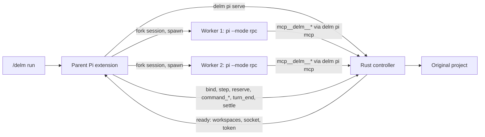

# Native Pi integration

Pi ([pi.dev](https://pi.dev), `@earendil-works/pi-coding-agent`) is the third DeLM host. It shares the
Rust runtime, the task board, contributions, check receipts, service ownership, workspace capture and
guarded delivery with Codex and Claude Code. Pi supplies native execution, sessions and lifecycle
events through its extension API and RPC mode. Pi resources live in `hosts/pi/`; the controller and
transport are the host-neutral Claude controller in `src/claude/`, reached through `delm pi ...`.

## Design

Pi has no in-process fork of a conversation into parallel agents. Its building blocks are:

- an extension API (TypeScript, loaded with jiti) with commands, tools, lifecycle events, a `tool_call`
  event that can rewrite a tool's input before execution, and `registerMcpServer`;
- an RPC mode (`pi --mode rpc`) that runs one agent as a child process driven by JSONL commands and
  streams every session event, including `tool_execution_start` and `tool_execution_end`;
- session files that can be forked into a new session for another working directory
  (`SessionManager.forkFrom`, `pi --session <file>`).

So the Pi host follows the Claude shape, not the Codex shape: the parent session's DeLM extension owns
the two workers, and the shared Rust controller owns the board, evidence and delivery.



### Invocation

`/delm run <task>` is a Pi command registered by `hosts/pi/extensions/delm.ts`. It starts
`delm pi serve` with the project, the parent session id and the task, reads the ready contract
(run id, control socket, token, runtime executable, two worker directories, revision), and keeps that
process as the run's bridge. `/delm stop` cancels; `/delm status` reports.

### Workers

For each worker the extension forks the parent session file into the worker's private directory
(`SessionManager.forkFrom(parentFile, workerCwd)`), so both workers inherit the conversation up to
the invocation, then spawns

```
pi --mode rpc --session <forked file> --append-system-prompt <worker policy> \
   --extension <hosts/pi/extensions/delm-worker.ts> --model <parent model> --thinking <level>
```

with `cwd` set to the private directory and `DELM_PI_WORKER` set to the slot. The worker policy is
the shared `plugin/worker.md` plus a short Pi note (tool prefix, how to end a turn). The worker
extension registers the DeLM MCP server (`delm pi mcp`, `exposure: direct`) at `session_start`, so the
model sees `mcp__delm__delm_publish` and the other coordination tools as ordinary tools.

Each worker's RPC stdout is the parent's event source. `agent_start` binds a new native turn
(`step`), `tool_execution_start`/`end` for `bash` record command evidence (`command_start`,
`command_end` with the tool's `exit_code`), and `agent_settled` retires the turn (`turn_end` with the
last assistant text). Controller actions map to RPC commands: `resume` → `prompt`, `context` → `steer`
on an active worker, `stop` → `abort` then stdin close.

### Coordination tickets

A worker's MCP sidecar (`delm pi mcp`) consumes one-use tickets exactly as Claude's does. Tickets are
reserved by the parent extension, which holds the control token. The worker never sees that token:
its extension's `tool_call` handler asks the parent over a per-worker Unix socket (`DELM_PI_BRIDGE`)
for a ticket for the exact tool and arguments, then injects `_delm: {socket, ticket}` into the call.
The controller checks worker, turn, revision, tool and arguments on consumption, so a modified, stale
or replayed call cannot mutate the board. Like the Codex adapter, this is a trusted local development
boundary, not protection against hostile code running as the user.

### Evidence

Pi's `bash` tool returns `structuredContent.exit_code` and sets `isError` on a non-zero exit. The
adapter records `CommandCompletion::NativeProcess` with that exit code under `NativeHost::Pi`.
Background or interrupted commands (a thrown abort or timeout) produce no `tool_execution_end`
result with an exit code and do not qualify as completed checks.

### The board

`/delm:run` opens a live board above the editor: phase, both agents with their state and claimed task,
the task queue, the latest shared contribution and the recorded-check count, and the outcome when the
run ends. It is rendered from the passive observer (`delm pi view --watch`), which reads the run records
without touching the controller. `/delm:board hide` hides it for the run, `/delm:status` or `/delm:board`
reopens it, and `/delm:board tasks|shared|checks` opens a scrollable detail overlay (Esc closes). The
final state stays visible until hidden or until the next run starts.

### Recovery

If the Pi session ends while a run is active, the workers and bridge exit with it and the run record
keeps the project locked. The next session in that project is told so at start; `/delm:recover`
confirms through the controller's tokenless path that the old bridge and host have exited, saves the
unfinished changes under the run's `workspace/recovery`, removes the worker trees and releases the
project.

### Updates, completion, shutdown

A follow-up `/delm run` while a run is active, or plain text sent while the run owns input, is
forwarded with `update`; active workers receive it by `steer`, idle ones by `prompt`. A `candidate`
action (a worker completed) starts finalization: the other worker is stopped, both processes exit,
and `settle` delivers through the shared path. `/delm stop` or a parent exit cancels. Recovery after a
parent restart reuses `delm pi recover` with the durable `pi.json` record.

## What is not inherited

Pi forks copy the conversation entries; they do not copy the parent's live extension state, MCP
connections or in-memory tool selection. Workers load the user's ordinary extensions, skills and
project context from the private copy as any `pi` process would. The run record lists the parent
model, thinking level and tools observed at launch; it does not claim parity with every live
customization of the parent session.

## Status

Exercised so far:

- the parent extension loads under Pi 1.2.0 in RPC mode, `/delm:run`, `/delm:status` and `/delm:stop` register, and a command typed as an RPC prompt reaches its handler;
- the worker extension registers the DeLM MCP server with direct exposure, and all fifteen `mcp__delm__*` tools appear in the worker's tool list;
- the lifecycle fixture (`hosts/pi/tests/lifecycle.test.mjs`) runs the real parent extension, controller, sidecar and delivery with two scripted workers: one runs a real bash command, cites it as a check, and completes; the result is delivered into the original project with unrelated files intact.

- one real run on Pi 1.2.0 with `anthropic/claude-opus-4-8` (2026-10-22): two workers forked from the
  session, one implemented `hello.py` and `test_hello.py`, ran pytest through a check receipt (exit 0),
  published and completed; the other read the board and stood down; delivery into the original project
  completed with no conflicts and both worker trees removed, about 70 seconds end to end.

- `hosts/pi/tests/live-lifecycle.mjs` drives the installed Pi 1.4.0 in RPC mode with a real model
  through three scenarios, all passing on 2026-10-22: a typed update mid-run reached both peers and its
  extra function was delivered; `/delm:stop` left no worker process, no unfinished run and an unchanged
  project; a killed session left no worker process, the next session reported the unfinished run, and
  `/delm:recover` saved its changes and released the project. It bills the provider login and is run
  explicitly, not by `npm test`.

Not exercised yet: steering an actively streaming worker from the UI, a parent restart with recovery, forked session inheritance against a real session file, Intel macOS, and distribution through the npm installer. See [development](development.md#pi-plugin) for the contributor build.
